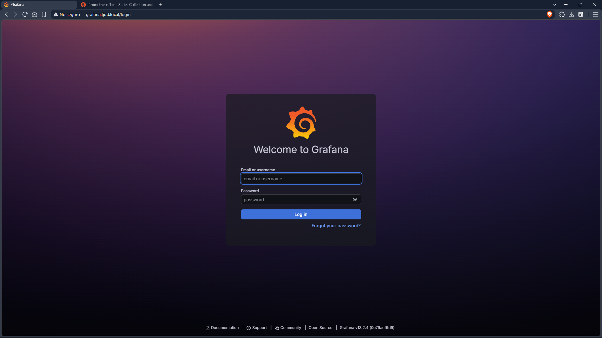
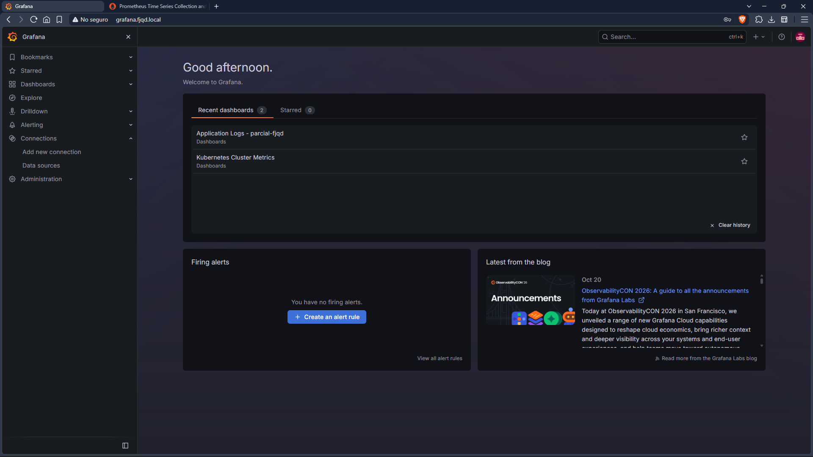
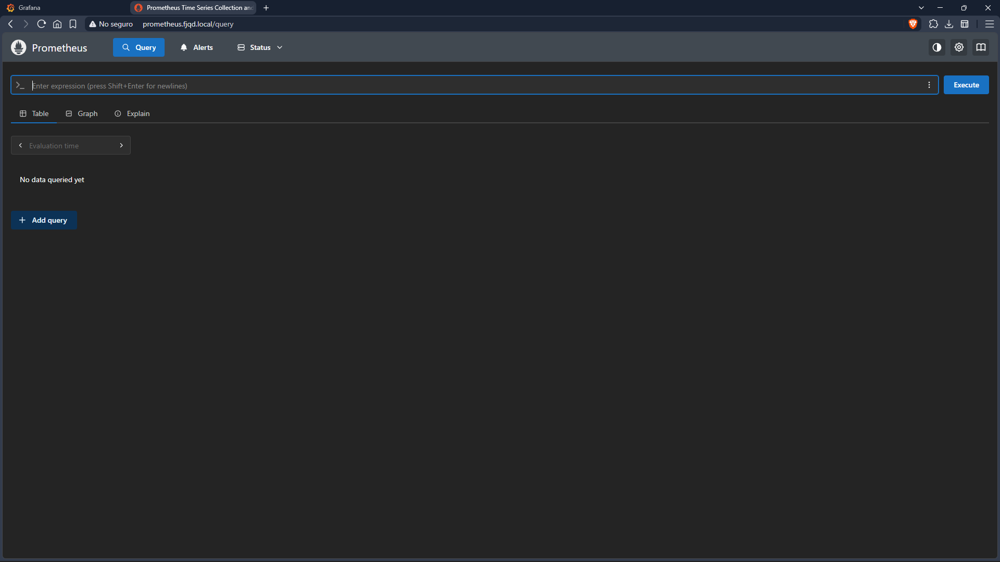
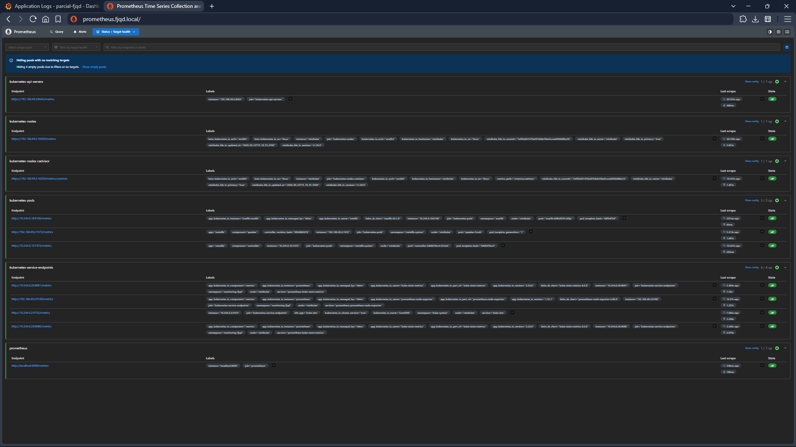
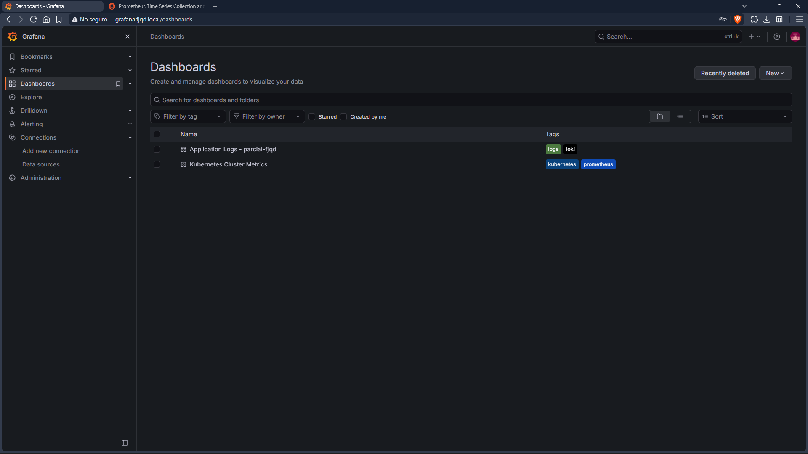
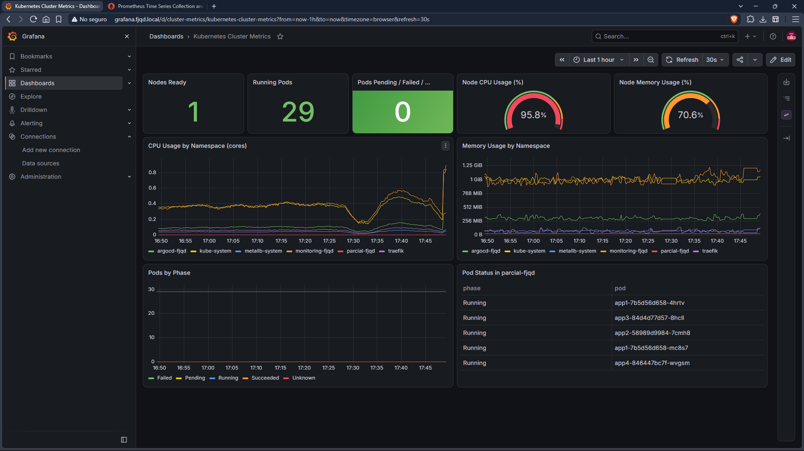
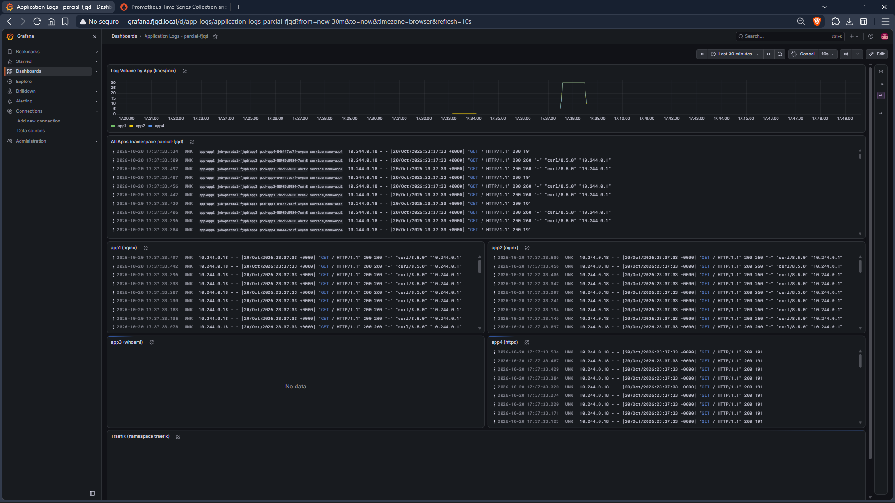
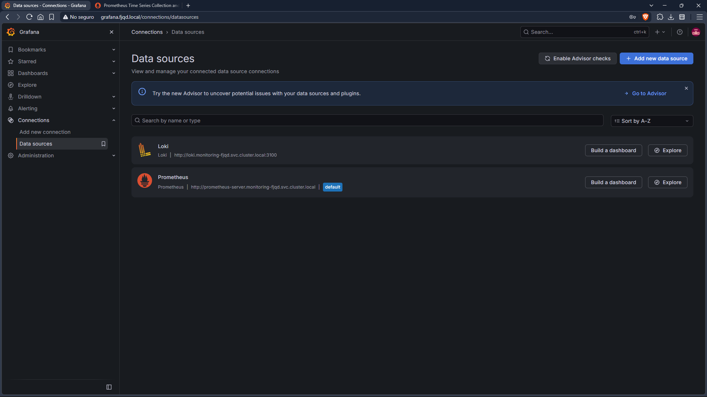
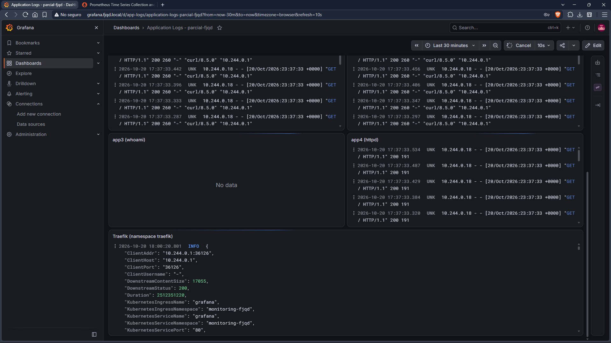

# Virtualization_homeworks
This repository is only for virtualization homeworks and assessment
# Personal Project 01 - Monitoring and Centralized Logging with Prometheus, Loki, Promtail and Grafana

This branch (`personal-project-01`) documents how a monitoring and log centralization stack was deployed inside the local Minikube cluster, using **Prometheus** (metrics), **Loki** (log storage), **Promtail** (log collector) and **Grafana** (visualization). Grafana and Prometheus are exposed through **Traefik** using the LoadBalancer IP provided by **MetalLB**.

All configuration is stored as Infrastructure as Code: Helm `values.yaml` files, Kubernetes YAML files, and the Grafana data sources and dashboards (JSON) provisioned from code.

## Namespaces

| Namespace | Purpose |
|---|---|
| `monitoring-fjqd` | **All** monitoring components: Prometheus, Loki, Promtail and Grafana (`monitoring-` + my initials) |
| `parcial-fjqd` | The 4 web applications (app1 to app4) |
| `traefik` | Traefik ingress controller |
| `metallb-system` | MetalLB |

## Step 1 - Enable Traefik Access Logs

Traefik writes very little to its log by default. To have meaningful Traefik logs in Loki, access logs were enabled in `traefik/values.yaml`:

```yaml
logs:
  access:
    enabled: true
```

```bash
helm upgrade traefik traefik/traefik -n traefik -f traefik/values.yaml
```

Traefik writes these logs to stdout, so Promtail collects them like any other container log.

## Step 2 - Namespace and Helm Repositories

The whole stack lives in a single namespace (`monitoring/namespace.yaml`):

```yaml
apiVersion: v1
kind: Namespace
metadata:
  name: monitoring-fjqd
```

```bash
kubectl apply -f monitoring/namespace.yaml

helm repo add prometheus-community https://prometheus-community.github.io/helm-charts
helm repo add grafana https://grafana.github.io/helm-charts
helm repo add grafana-community https://grafana-community.github.io/helm-charts
helm repo update
```

> Since March 2026 the Loki and Grafana charts are maintained in the `grafana-community` repository. The Promtail chart is still published in the `grafana` repository.

## Step 3 - Install Prometheus

`monitoring/prometheus/values.yaml`:

```yaml
alertmanager:
  enabled: false
prometheus-pushgateway:
  enabled: false

kube-state-metrics:
  enabled: true
prometheus-node-exporter:
  enabled: true

server:
  global:
    scrape_interval: 30s
  retention: 24h
  persistentVolume:
    enabled: true
    size: 5Gi

  ingress:
    enabled: true
    ingressClassName: traefik
    annotations:
      traefik.ingress.kubernetes.io/router.entrypoints: web
    hosts:
      - prometheus.fjqd.local
    path: /
```

```bash
helm install prometheus prometheus-community/prometheus \
  -n monitoring-fjqd -f monitoring/prometheus/values.yaml
```

**How cluster metrics are collected.** The chart ships with default scrape jobs that use Kubernetes service discovery:

| Source | What it provides |
|---|---|
| `kubernetes-nodes` / `kubernetes-nodes-cadvisor` | Kubelet and cAdvisor metrics: CPU and memory per container |
| `kube-state-metrics` | Object state: pod phases, deployments, nodes |
| `prometheus-node-exporter` | Node-level CPU, memory and disk |
| `kubernetes-apiservers` | Kubernetes API server metrics |
| `kubernetes-service-endpoints`, `kubernetes-pods` | Any service or pod annotated for scraping |
| `prometheus` | Prometheus itself |

Alertmanager and Pushgateway are disabled to save resources, since they are not required.

## Step 4 - Install Loki

Loki runs in **monolithic mode** (a single pod) with local filesystem storage, which is appropriate for a single-node Minikube cluster. The gateway, caches, canary and MinIO are disabled to reduce resource usage (`monitoring/loki/values.yaml`):

```yaml
deploymentMode: Monolithic

loki:
  auth_enabled: false
  commonConfig:
    replication_factor: 1
  storage:
    type: filesystem
  schemaConfig:
    configs:
      - from: "2024-04-01"
        store: tsdb
        object_store: filesystem
        schema: v13
        index:
          prefix: loki_index_
          period: 24h
  limits_config:
    allow_structured_metadata: true
    volume_enabled: true

singleBinary:
  replicas: 1
  persistence:
    enabled: true
    size: 5Gi

minio:
  enabled: false
gateway:
  enabled: false
chunksCache:
  enabled: false
resultsCache:
  enabled: false
lokiCanary:
  enabled: false
test:
  enabled: false
```

```bash
helm install loki grafana-community/loki \
  -n monitoring-fjqd -f monitoring/loki/values.yaml
```

Loki is reachable inside the cluster at `http://loki.monitoring-fjqd.svc.cluster.local:3100`. Multi-tenancy is disabled (`auth_enabled: false`), so no tenant header is needed.

## Step 5 - Install Promtail

`monitoring/promtail/values.yaml`:

```yaml
config:
  clients:
    - url: http://loki.monitoring-fjqd.svc.cluster.local:3100/loki/api/v1/push
```

```bash
helm install promtail grafana/promtail \
  -n monitoring-fjqd -f monitoring/promtail/values.yaml

kubectl get daemonset -n monitoring-fjqd
```

**How Promtail collects the logs.**

- It is deployed as a **DaemonSet**: one pod per node, mounting the node's `/var/log/pods` directory (read-only).
- The chart's default scrape configuration uses Kubernetes service discovery (`role: pod`), so it automatically discovers **every pod in the cluster**. This includes the four applications of `parcial-fjqd` and Traefik in the `traefik` namespace, which are the required minimum.
- The `cri` pipeline stage parses the log format of containerd (the Minikube container runtime).
- Each log line is labeled by relabeling rules:

| Label | Origin | Example |
|---|---|---|
| `namespace` | Pod namespace | `parcial-fjqd`, `traefik` |
| `pod` | Pod name | `app1-7b5d56d658-4bnzb` |
| `container` | Container name | `web` |
| `app` | Pod label `app.kubernetes.io/name`, or else `app` | `app1`, `app2`, `app3`, `app4`, `traefik` |
| `job` | `namespace/app` | `parcial-fjqd/app1` |
| `node_name` | Node name | `minikube` |

These labels are what the dashboards use to identify the logs of each application, e.g. `{namespace="parcial-fjqd", app="app3"}`.

> **Note:** Promtail reached end-of-life on March 2, 2026 (Grafana Alloy is its successor). It is used here because it is the component required by the assignment, and the chart is still installable.

## Step 6 - Install Grafana

`monitoring/grafana/values.yaml`:

```yaml
adminUser: admin

persistence:
  enabled: false

grafana.ini:
  server:
    domain: grafana.fjqd.local
    root_url: http://grafana.fjqd.local

datasources:
  datasources.yaml:
    apiVersion: 1
    datasources:
      - name: Prometheus
        uid: prometheus
        type: prometheus
        access: proxy
        url: http://prometheus-server.monitoring-fjqd.svc.cluster.local
        isDefault: true
      - name: Loki
        uid: loki
        type: loki
        access: proxy
        url: http://loki.monitoring-fjqd.svc.cluster.local:3100

sidecar:
  dashboards:
    enabled: true
    label: grafana_dashboard
    labelValue: "1"

ingress:
  enabled: true
  ingressClassName: traefik
  annotations:
    traefik.ingress.kubernetes.io/router.entrypoints: web
  hosts:
    - grafana.fjqd.local
  path: /
```

```bash
helm install grafana grafana-community/grafana \
  -n monitoring-fjqd -f monitoring/grafana/values.yaml
```

The `admin` password is generated automatically by the chart and stored in a Kubernetes secret (it is **not** stored in the repository):

```bash
kubectl get secret grafana -n monitoring-fjqd \
  -o jsonpath="{.data.admin-password}" | base64 -d; echo
```

## Step 7 - Grafana Data Sources and Dashboards (Provisioning)

Nothing was configured manually from the Grafana UI.

### Data sources

Prometheus and Loki are defined in the `datasources` section of `monitoring/grafana/values.yaml` (shown above). The chart renders it into a provisioning file that Grafana loads at startup. Each data source has a fixed `uid` (`prometheus` and `loki`), so the dashboard JSON files can reference them reliably.

### Dashboards

Dashboards are stored as JSON files in `monitoring/grafana/dashboards/`. A `kustomization.yaml` turns them into ConfigMaps labeled `grafana_dashboard: "1"`:

```yaml
apiVersion: kustomize.config.k8s.io/v1beta1
kind: Kustomization

namespace: monitoring-fjqd

generatorOptions:
  disableNameSuffixHash: true
  labels:
    grafana_dashboard: "1"

configMapGenerator:
  - name: dashboard-cluster-metrics
    files:
      - cluster-metrics.json
  - name: dashboard-app-logs
    files:
      - app-logs.json
```

```bash
kubectl apply -k monitoring/grafana/dashboards
```

The Grafana **sidecar** container watches for ConfigMaps with that label and loads them automatically as dashboards.

### Dashboard 1: Kubernetes Cluster Metrics (`cluster-metrics.json`)

Data source: Prometheus.

| Panel | Query (PromQL) |
|---|---|
| Nodes Ready | `sum(kube_node_status_condition{condition="Ready",status="true"})` |
| Running Pods | `sum(kube_pod_status_phase{phase="Running"})` |
| Pods Pending / Failed / Unknown | `sum(kube_pod_status_phase{phase=~"Pending\|Failed\|Unknown"}) or vector(0)` |
| Node CPU Usage (%) | `100 - (avg(rate(node_cpu_seconds_total{mode="idle"}[5m])) * 100)` |
| Node Memory Usage (%) | `(1 - sum(node_memory_MemAvailable_bytes) / sum(node_memory_MemTotal_bytes)) * 100` |
| CPU Usage by Namespace | `sum by (namespace) (rate(container_cpu_usage_seconds_total{container!="",container!="POD"}[5m]))` |
| Memory Usage by Namespace | `sum by (namespace) (container_memory_working_set_bytes{container!="",container!="POD"})` |
| Pods by Phase | `sum by (phase) (kube_pod_status_phase)` |
| Pod Status in parcial-fjqd | `sum by (pod, phase) (kube_pod_status_phase{namespace="parcial-fjqd"} == 1)` |

### Dashboard 2: Application Logs - parcial-fjqd (`app-logs.json`)

Data source: Loki.

| Panel | Query (LogQL) |
|---|---|
| Log Volume by App (lines/min) | `sum by (app) (count_over_time({namespace="parcial-fjqd"}[1m]))` |
| All Apps (shows the `app` label) | `{namespace="parcial-fjqd"}` |
| app1 (nginx) | `{namespace="parcial-fjqd", app="app1"}` |
| app2 (nginx) | `{namespace="parcial-fjqd", app="app2"}` |
| app3 (whoami) | `{namespace="parcial-fjqd", app="app3"}` |
| app4 (httpd) | `{namespace="parcial-fjqd", app="app4"}` |
| Traefik | `{namespace="traefik"}` |

## Step 8 - Exposure Through Traefik and Local DNS

Both Grafana and Prometheus are exposed through Ingress resources of class `traefik`, created by their Helm charts from the `ingress` section of each `values.yaml` (hosts `grafana.fjqd.local` and `prometheus.fjqd.local`).

```bash
kubectl get ingress -n monitoring-fjqd
```

Two new DNS names were added to the local hosts files, using the same domain as the previous assignments (`fjqd.local`).

**WSL2** (`/etc/hosts`):

```bash
echo "127.0.0.1 grafana.fjqd.local prometheus.fjqd.local" | sudo tee -a /etc/hosts
```

**Windows** (`C:\Windows\System32\drivers\etc\hosts`, edited as Administrator, needed for the Windows browser):

```
127.0.0.1 grafana.fjqd.local prometheus.fjqd.local
```

```powershell
ipconfig /flushdns
```

The names point to `127.0.0.1` because of the Docker Desktop limitation described in the next section. The traffic still reaches the Traefik LoadBalancer Service (`192.168.49.200`, assigned by MetalLB).

## Screenshots

**Grafana accessed from the browser using the domain name**



**Grafana home page**



**Prometheus accessed from the browser using the domain name**



**Prometheus Targets in state UP**



**Grafana dashboads**



**Dashboard: Kubernetes Cluster Metrics (CPU, memory and pod status)**



**Dashboard: Application Logs (logs of app1, app2, app3 and app4)**



**Additional evidence**

| Evidence | Screenshot |
|---|---|
| Data sources provisioned (Prometheus and Loki) |  |
| Traefik logs in Loki |  |