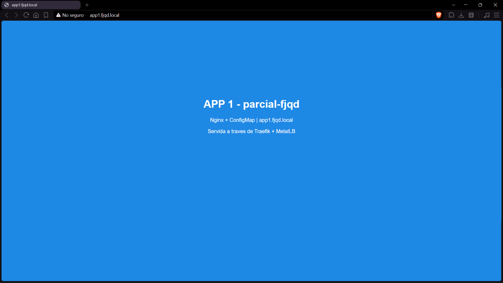
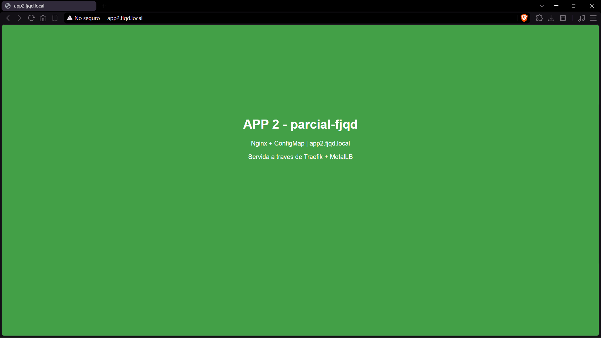
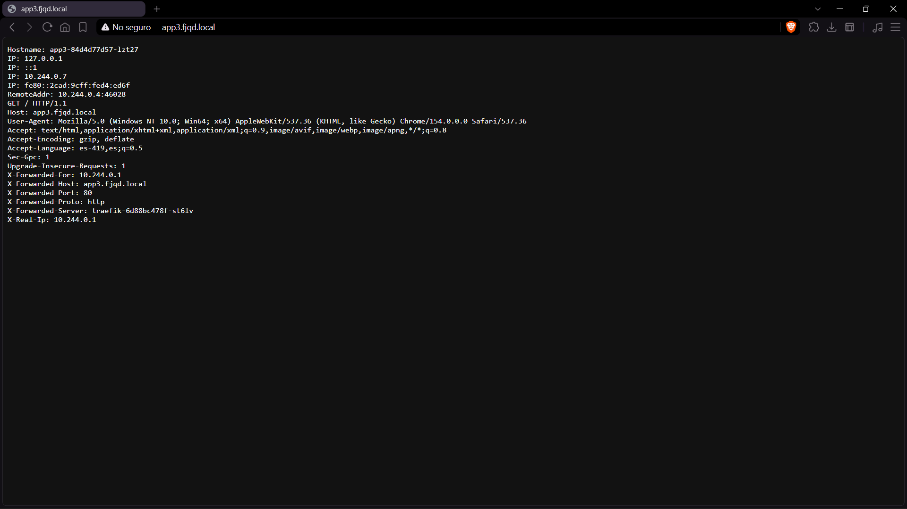
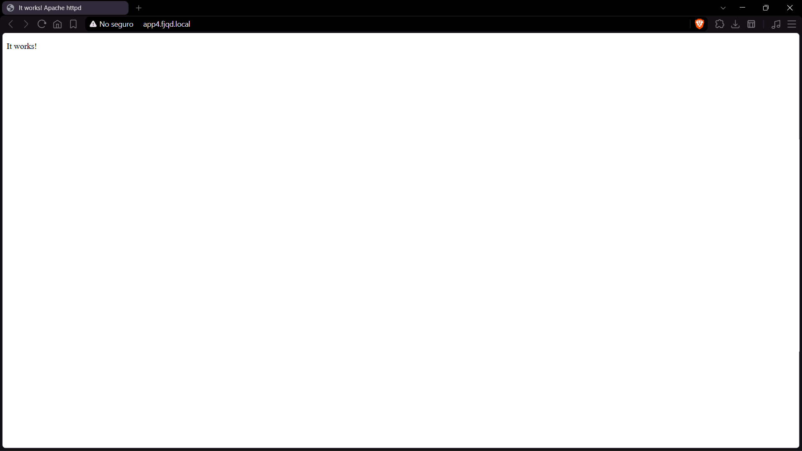
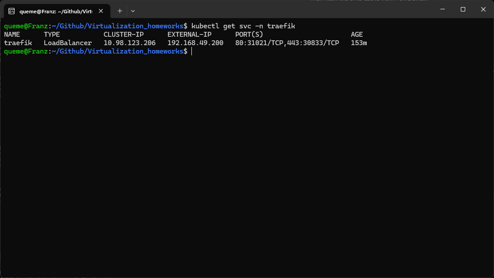

# Assessment 02 - Kubernetes, Traefik and MetalLB: Exposing Services Through a Single IP

This branch (`assessment-02`) documents how to configure **MetalLB** and **Traefik** on a local **Minikube** cluster so that four web applications are exposed through a **single IP address** using host-based routing.

All configuration is stored as Infrastructure as Code (YAML files) in this repository.

## Files Structure

```
.
├── README.md
├── metallb/
│   ├── metallb-native.yaml      # MetalLB manifests (namespace metallb-system)
│   └── ipaddresspool.yaml       # Single-IP pool + L2Advertisement
├── traefik/
│   └── values.yaml              # Helm values (LoadBalancer + MetalLB IP)
├── apps/
│   ├── namespace.yaml           # Namespace parcial-fjqd
│   ├── app1.yaml                # nginx + ConfigMap (blue)
│   ├── app2.yaml                # nginx + ConfigMap (green)
│   ├── app3.yaml                # traefik/whoami
│   ├── app4.yaml                # Apache httpd
│   └── ingress.yaml             # Host-based routing through Traefik
└── docs/
    └── img/                     # Screenshots
```

## Namespaces

| Namespace | Purpose |
|---|---|
| `metallb-system` | MetalLB controller and speakers |
| `traefik` | Traefik ingress controller |
| `parcial-fjqd` | The 4 applications (Deployments, Services, Ingress) |

## Install MetalLB

Download the official manifest into the repository (so it is versioned as IaC) and apply it:

```bash
curl -L -o metallb/metallb-native.yaml \
  https://raw.githubusercontent.com/metallb/metallb/v0.14.9/config/manifests/metallb-native.yaml

kubectl apply -f metallb/metallb-native.yaml
kubectl wait --namespace metallb-system --for=condition=ready pod \
  --selector=app=metallb --timeout=120s
```

This manifest creates the `metallb-system` namespace automatically.

Then define the IP pool with **only one IP address** and advertise it in Layer 2 mode (`metallb/ipaddresspool.yaml`):

```yaml
apiVersion: metallb.io/v1beta1
kind: IPAddressPool
metadata:
  name: single-ip-pool
  namespace: metallb-system
spec:
  addresses:
    - 192.168.49.200/32
---
apiVersion: metallb.io/v1beta1
kind: L2Advertisement
metadata:
  name: l2-adv
  namespace: metallb-system
spec:
  ipAddressPools:
    - single-ip-pool
```

```bash
kubectl apply -f metallb/ipaddresspool.yaml
kubectl get pods -n metallb-system
```

## Install Traefik

Traefik is installed with Helm in its own namespace (`traefik`). The Service is of type `LoadBalancer` and requests the specific IP from MetalLB through an annotation (`traefik/values.yaml`):

```yaml
service:
  type: LoadBalancer
  annotations:
    metallb.io/loadBalancerIPs: 192.168.49.200

ingressClass:
  enabled: true
  isDefaultClass: true

providers:
  kubernetesIngress:
    enabled: true
    publishedService:
      enabled: true
```

Installation:

```bash
helm repo add traefik https://traefik.github.io/charts
helm repo update
helm install traefik traefik/traefik \
  --namespace traefik --create-namespace \
  -f traefik/values.yaml
```

## Ingress Configuration

The Services are handled by Traefik through a single Ingress resource that uses the `traefik` IngressClass and routes by domain name (`apps/ingress.yaml`):

```yaml
apiVersion: networking.k8s.io/v1
kind: Ingress
metadata:
  name: apps-ingress
  namespace: parcial-fjqd
  annotations:
    traefik.ingress.kubernetes.io/router.entrypoints: web
spec:
  ingressClassName: traefik
  rules:
    - host: app1.fjqd.test
      http:
        paths:
          - path: /
            pathType: Prefix
            backend:
              service: { name: app1, port: { number: 80 } }
    - host: app2.fjqd.test
      http:
        paths:
          - path: /
            pathType: Prefix
            backend:
              service: { name: app2, port: { number: 80 } }
    - host: app3.fjqd.test
      http:
        paths:
          - path: /
            pathType: Prefix
            backend:
              service: { name: app3, port: { number: 80 } }
    - host: app4.fjqd.test
      http:
        paths:
          - path: /
            pathType: Prefix
            backend:
              service: { name: app4, port: { number: 80 } }
```

```bash
kubectl apply -f apps/ingress.yaml
kubectl get ingress -n parcial-fjqd
```

## Local DNS Configuration

No domain was purchased. Four hostnames under the fictional domain `fjqd.test` (the `.test` TLD is reserved for testing) were added to the local hosts files.

**WSL2** (`/etc/hosts`):

```bash
echo "127.0.0.1 app1.fjqd.test app2.fjqd.test app3.fjqd.test app4.fjqd.test" | sudo tee -a /etc/hosts
```

**Windows** (`C:\Windows\System32\drivers\etc\hosts`, edited as Administrator, needed for the Windows browser):

```
127.0.0.1 app1.fjqd.test app2.fjqd.test app3.fjqd.test app4.fjqd.test
```

Then flush the DNS cache from PowerShell:

```powershell
ipconfig /flushdns
```
## Evidence

Access to each web service from the browser using the domain names.

| App | Screenshot |
|---|---|
| app1 (nginx, blue) |  |
| app2 (nginx, green) |  |
| app3 (whoami) |  |
| app4 (httpd) |  |

Additional evidence:

| Evidence | Screenshot |
|---|---|
| `kubectl get svc -n traefik` |  |
| `kubectl get all,ingress -n parcial-fjqd` |  |