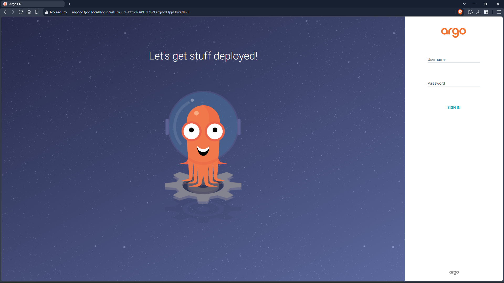
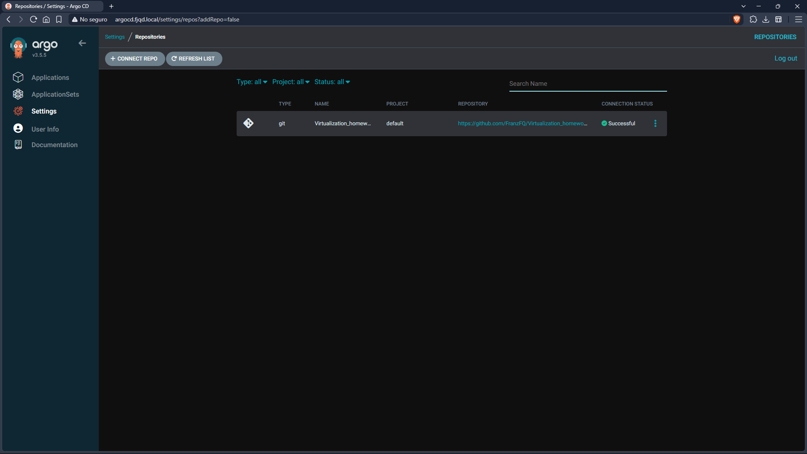
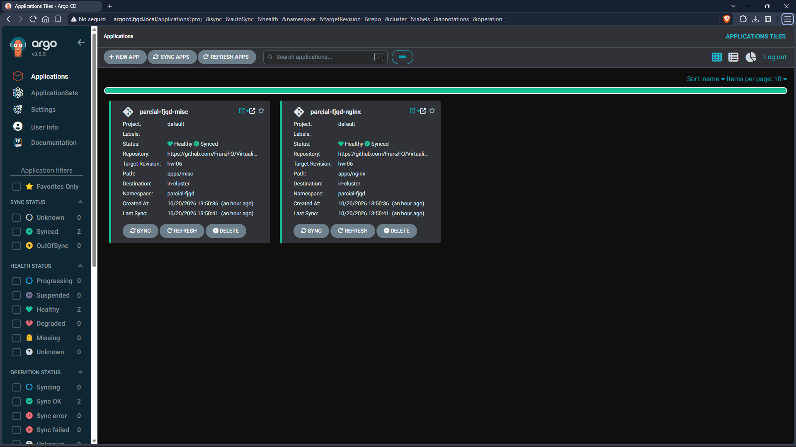
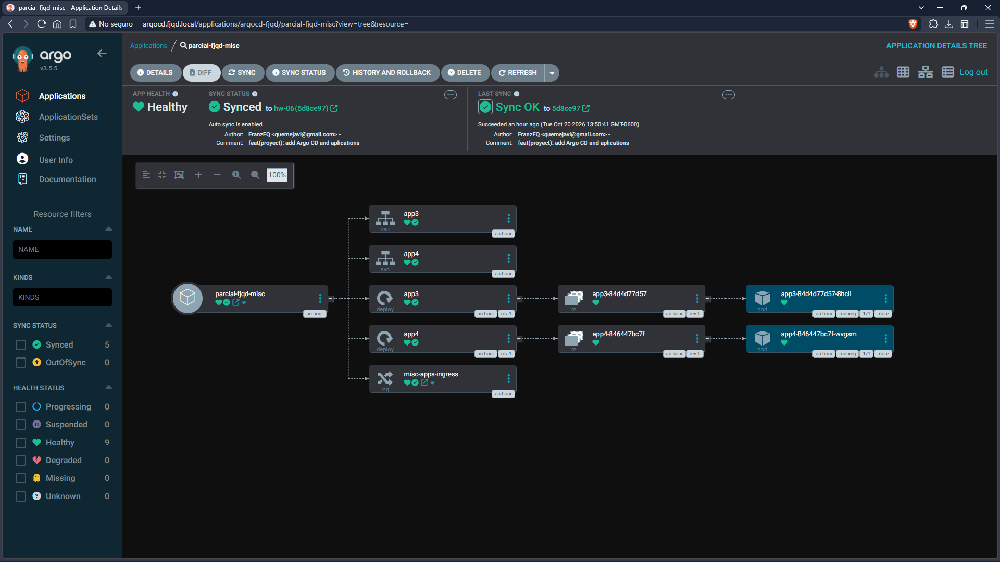
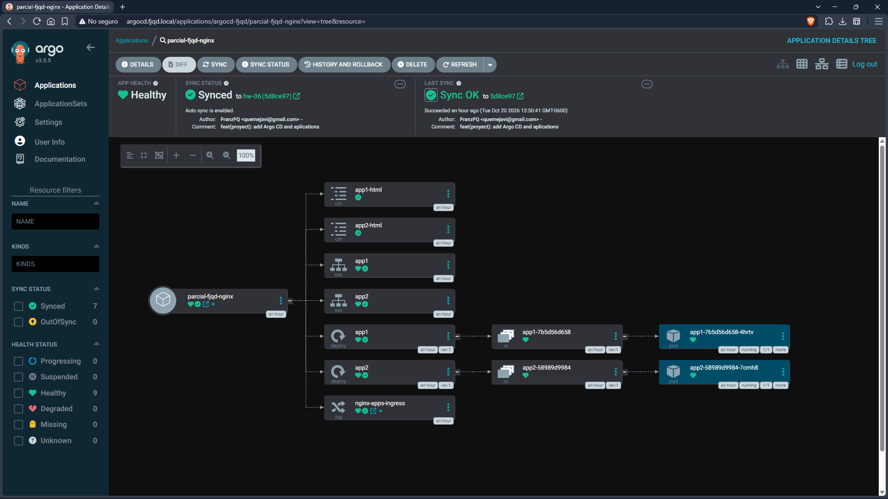
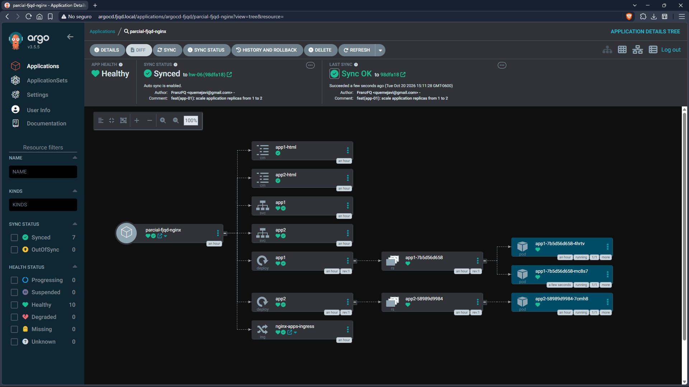

# HW-06 - GitOps with Argo CD on Minikube

This branch (`HW-06`) documents how **Argo CD** was installed in the local Minikube cluster, exposed through **Traefik** with a local domain name, connected to this GitHub repository, and used to deploy the applications of the `parcial-fjqd` namespace following the **GitOps** approach.

All configuration is stored as Infrastructure as Code (YAML files), including the Argo CD `Application` definitions.

## Namespaces

| Namespace | Purpose |
|---|---|
| `argocd-fjqd` | Argo CD |
| `parcial-fjqd` | The web applications managed by Argo CD |
| `traefik` | Traefik ingress controller |
| `metallb-system` | MetalLB |

## Step 1 - Install Argo CD

Argo CD is installed with Helm in its own namespace, `argocd-fjqd`. Helm is used instead of the official `install.yaml` because that manifest has the `argocd` namespace hardcoded in several resources and does not work well with a custom namespace.

Helm values (`argocd/values.yaml`):

```yaml
global:
  domain: argocd.fjqd.local

configs:
  params:
    # Traefik terminates the connection; Argo CD serves plain HTTP internally
    server.insecure: true
  cm:
    # Poll the repository every 60s (default is 180s)
    timeout.reconciliation: 60s

server:
  ingress:
    # The Ingress is defined separately in argocd/ingress.yaml (IaC)
    enabled: false
```

Installation:

```bash
helm repo add argo https://argoproj.github.io/argo-helm
helm repo update

helm install argocd argo/argo-cd \
  --namespace argocd-fjqd --create-namespace \
  -f argocd/values.yaml

kubectl get pods -n argocd-fjqd
helm list -n argocd-fjqd
```

All pods reach the `Running` state (the `argocd-redis-secret-init` job shows `Completed`, which is expected).

The initial password for the `admin` user is stored in a secret:

```bash
kubectl -n argocd-fjqd get secret argocd-initial-admin-secret \
  -o jsonpath="{.data.password}" | base64 -d; echo
```

## Step 2 - Expose Argo CD Through Traefik

`server.insecure: true` makes the Argo CD server speak plain HTTP, so Traefik can route to it without dealing with TLS passthrough. The Ingress (`argocd/ingress.yaml`) uses the `traefik` IngressClass:

```yaml
apiVersion: networking.k8s.io/v1
kind: Ingress
metadata:
  name: argocd-server
  namespace: argocd-fjqd
  annotations:
    traefik.ingress.kubernetes.io/router.entrypoints: web
spec:
  ingressClassName: traefik
  rules:
    - host: argocd.fjqd.local
      http:
        paths:
          - path: /
            pathType: Prefix
            backend:
              service:
                name: argocd-server
                port:
                  number: 80
```

```bash
kubectl apply -f argocd/ingress.yaml
kubectl get ingress -n argocd-fjqd
```

## Step 3 - Local DNS Configuration

No domain was purchased. All hostnames use the fictional `fjqd.local` domain and are resolved through the local hosts files.

**WSL2** (`/etc/hosts`):

```bash
echo "127.0.0.1 argocd.fjqd.local app1.fjqd.local app2.fjqd.local app3.fjqd.local app4.fjqd.local" | sudo tee -a /etc/hosts
```

**Windows** (`C:\Windows\System32\drivers\etc\hosts`, edited as Administrator, needed for the Windows browser):

```
127.0.0.1 argocd.fjqd.local app1.fjqd.local app2.fjqd.local app3.fjqd.local app4.fjqd.local
```

Flush the DNS cache from PowerShell:

```powershell
ipconfig /flushdns
```

The names point to `127.0.0.1` because of the Docker Desktop network limitation described in [section 12](#12-docker-desktop--wsl2-network-limitation). The traffic still ends up in the Traefik LoadBalancer Service (`192.168.49.200`).

## Step 4 - Connect the GitHub Repository

In the Argo CD UI (`http://argocd.fjqd.local`):

1. Go to **Settings -> Repositories -> + CONNECT REPO**.
2. Connection method: **VIA HTTPS**, Type: `git`, Project: `default`.
3. Repository URL: `https://github.com/<USER>/<REPO>.git`
4. Click **CONNECT**.

The repository appears with the connection status **Successful**.

> If the repository is private, a GitHub Personal Access Token (fine-grained, `Contents: Read-only`) is used as the password. The token is not stored in this repository.

## Step 5 - Create the Applications

Two Argo CD `Application` resources were created. Each one watches a different folder of this repository on the `HW-06` branch and deploys its content into the `parcial-fjqd` namespace.

| Application | Path in repo | Resources |
|---|---|---|
| `parcial-fjqd-nginx` | `apps/nginx` | app1, app2 (ConfigMaps, Deployments, Services) + Ingress |
| `parcial-fjqd-misc` | `apps/misc` | app3, app4 (Deployments, Services) + Ingress |

`argocd/applications/parcial-fjqd-nginx.yaml`:

```yaml
apiVersion: argoproj.io/v1alpha1
kind: Application
metadata:
  name: parcial-fjqd-nginx
  namespace: argocd-fjqd
spec:
  project: default
  source:
    repoURL: https://github.com/<USER>/<REPO>.git
    targetRevision: HW-06
    path: apps/nginx
  destination:
    server: https://kubernetes.default.svc
    namespace: parcial-fjqd
  syncPolicy:
    automated:
      prune: true
      selfHeal: true
    syncOptions:
      - CreateNamespace=true
```

`argocd/applications/parcial-fjqd-misc.yaml` is identical except for `name: parcial-fjqd-misc` and `path: apps/misc`.

Key points:

- `namespace: argocd-fjqd` in the metadata: Applications must live in the namespace where Argo CD is installed.
- `targetRevision: HW-06`: Argo CD tracks the branch of this assignment.
- `automated` with `prune` and `selfHeal`: changes in Git are applied automatically, resources deleted from Git are removed from the cluster, and manual changes in the cluster are reverted.
- `CreateNamespace=true`: Argo CD creates the `parcial-fjqd` namespace if it does not exist.

Before creating the Applications, the resources deployed manually in the previous assignment were removed (`kubectl delete -f apps/namespace.yaml`), so Argo CD creates everything from scratch.

```bash
git push -u origin HW-06

kubectl apply -f argocd/applications/
kubectl get applications -n argocd-fjqd
kubectl get all,ingress -n parcial-fjqd
```

Result: both Applications are **Synced** and **Healthy**, and the four sites are reachable at `http://app1.fjqd.local` ... `http://app4.fjqd.local`.

## Step 6 - Change in the Repository and Automatic Sync

To verify the GitOps flow, the number of replicas of `app1` was changed from 1 to 2 in `apps/nginx/app1.yaml`:

```bash
sed -i 's/replicas: 1/replicas: 2/' apps/nginx/app1.yaml
git commit -am "app1: scale to 2 replicas"
git push
```

Argo CD detected the new commit (polling every 60 seconds, or immediately with the **Refresh** button), synchronized it automatically, and the Deployment scaled up:

```bash
kubectl get pods -n parcial-fjqd
```

The `parcial-fjqd-nginx` Application stayed **Synced** and **Healthy**, now showing two `app1` pods in the resource tree. No `kubectl apply` was run: the only action was the `git push`.

## Verification Commands

```bash
# Argo CD
kubectl get pods -n argocd-fjqd
kubectl get ingress -n argocd-fjqd
kubectl get applications -n argocd-fjqd

# Traefik / MetalLB
kubectl get svc -n traefik
kubectl get pods -n metallb-system

# Applications
kubectl get all,ingress,configmap -n parcial-fjqd

# Access by domain name
curl --max-time 5 http://argocd.fjqd.local
curl --max-time 5 http://app1.fjqd.local
curl --max-time 5 http://app2.fjqd.local
curl --max-time 5 http://app3.fjqd.local
curl --max-time 5 http://app4.fjqd.local
```

## Screenshots

**Argo CD accessed from the browser using the domain name**



**Repository connected**



**Applications Synced and Healthy - before the change**



**Misc applications**



**Nginx applications**



**Applications Synced and Healthy - after the change in nginx applications (App-01 2 replicas)**


**Nginx applications**


